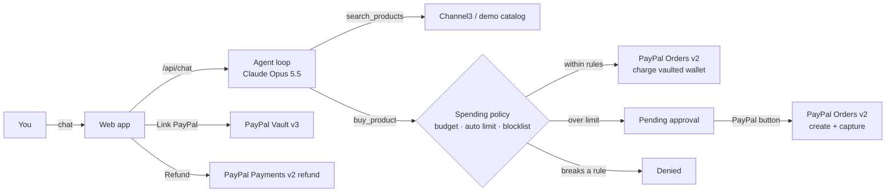

# Errand

**An AI shopping agent that pays with PayPal, on a spending leash you control.**

Tell Errand what you need ("get my dad a birthday gift under $60, he loves fishing"). It searches real stores, compares the options, picks one and pays with your PayPal wallet. But it can only spend inside rules **you** set: a monthly budget, a limit for hands-free purchases, and a list of things it must never buy. Anything bigger waits for you to approve it in a PayPal popup, and any purchase can be refunded in one click.

Built for the [Build What's Next with PayPal and AI](https://paypalaihackathon.devpost.com/) hackathon.

## Why

AI agents are getting good at shopping, but handing one your wallet is scary. Most "agentic checkout" demos either let the agent spend freely or ask you to confirm every single purchase, which defeats the point. Errand sits in between: routine errands just happen, and the agent physically can't go past the limits you set, because the limits are enforced by the server in front of every PayPal call, not by asking the model nicely.

## What it does

| You say | What happens |
|---|---|
| "Get my dad a birthday gift under $60. He loves fishing." | Searches, shows the options, explains its pick, and pays $34.99 on its own because it's under your $40 auto-approve limit. |
| "Buy the burr coffee grinder for the office." | $64.99 is over the auto-approve limit, so the purchase is parked and a PayPal button appears. You approve, PayPal captures. |
| "Get my sister a $50 gift card." | Gift cards are on your blocked list. The server denies it and the agent explains why. |
| Spend past your monthly budget | Denied, with how much is left. Pending approvals count against the budget so the agent can't queue up a pile of them. |
| Click **Refund** in the activity log | The PayPal capture is refunded and the budget is freed up. |

## How PayPal is used

| PayPal capability | Where |
|---|---|
| **Vault v3** (setup token → payment token) with the **JS SDK** `createVaultSetupToken` button | "Link PayPal" saves the user's PayPal wallet once, with no charge. `src/paypal.js`, `public/app.js` |
| **Orders v2** with `payment_source.paypal.vault_id` | Hands-free payment for purchases within the rules: the agent's purchase is created and captured in one call. |
| **Orders v2** create + capture with the **JS SDK** Buttons | Human approval for purchases over the limit. |
| **Payments v2** refunds | One-click refund of any paid purchase. |
| `PayPal-Request-Id` idempotency keys | Every money-moving call, so retries never double-charge. |

## How AI is used

- **Claude Opus 5.5** (`claude-opus-5-5`, Anthropic Messages API with tool use) is the agent. It has three tools: `search_products`, `get_spending_status` and `buy_product`. It decides what to search, compares results, picks the best fit and explains why, and handles the outcome (paid, needs approval, denied).
- The model **never** sees PayPal credentials and has **no tool that can change the rules**. `buy_product` goes through `src/policy.js` on the server, which decides whether money moves.
- The agent can only buy `product_id`s that its own search returned, and retailer text is treated as data, not instructions (prompt-injection hygiene).
- Server-side refusal fallback (`fallbacks: "default"`) is on, so a rare safety-classifier decline is retried on a fallback model in the same call.

Product data comes from **[Channel3](https://trychannel3.com)** (100M+ products from 25k+ retailers) when a key is set, or a built-in demo catalog otherwise.

## Architecture



```
server.js            Express routes (chat, rules, wallet linking, approvals, refunds)
src/agent.js         Claude tool-use loop and system prompt
src/policy.js        The spending leash (pure functions, unit tested)
src/purchases.js     Policy check + PayPal calls for each purchase
src/paypal.js        PayPal REST client (OAuth, Vault, Orders, Refunds) with a simulated mode
src/catalog.js       Channel3 search + demo catalog fallback
src/store.js         JSON-file state (data/state.json)
public/              Front end (plain HTML/CSS/JS, PayPal JS SDK)
test/                node:test suites for the policy and the full agent → PayPal path
```

## Run it

Requires **Node.js 18.18+**.

```bash
git clone https://github.com/Meghs21/errand-agent.git
cd errand-agent
npm install
cp .env.example .env     # then fill in the keys below
npm start                # http://localhost:3000
```

### Keys

| Variable | Needed? | Where to get it |
|---|---|---|
| `ANTHROPIC_API_KEY` | Yes, for the agent | [console.anthropic.com](https://console.anthropic.com) |
| `PAYPAL_CLIENT_ID`, `PAYPAL_CLIENT_SECRET` | Optional. Without them PayPal is simulated and the buttons say "(simulated)". | [PayPal Developer Dashboard](https://developer.paypal.com/dashboard/applications/sandbox) → Apps & Credentials → Sandbox → your app |
| `CHANNEL3_API_KEY` | Optional. Without it the demo catalog is used. | [trychannel3.com/developers](https://trychannel3.com/developers) (hackathon promo code `PAYPAL-HACKATHON-2026`) |

### PayPal sandbox setup

1. In the [Developer Dashboard](https://developer.paypal.com/dashboard/applications/sandbox), open your sandbox app and make sure **Save payment methods** (Vault) is enabled under the app's features. Hands-free payments need it.
2. Copy the app's client ID and secret into `.env`.
3. Under **Testing Tools → Sandbox Accounts**, note the email and password of the default **Personal** (buyer) account. Use it to log in when the PayPal popup asks, both for "Link PayPal" and for approvals.
4. After a purchase, you can see the payment in that sandbox buyer account and the matching business account at [sandbox.paypal.com](https://www.sandbox.paypal.com).

### Tests

```bash
npm test
```

The agent test drives the real agent loop, policy, store and (simulated) PayPal with a scripted stand-in for Claude, so it needs no keys.

## Try this demo script

1. Click **Link PayPal** and log in with your sandbox buyer account.
2. Click "Get my dad a birthday gift under $60. He loves fishing." The agent searches, picks, and pays on its own. The PayPal order and capture IDs show on the card.
3. Click "Buy the burr coffee grinder for the office." It's over the $40 limit, so approve it with the PayPal button.
4. Click "Get my sister a $50 gift card." Blocked.
5. Lower the monthly budget in **Spending leash** and ask for something else. Denied with how much is left.
6. Hit **Refund** on a purchase in **Activity**.

## Limitations

- One household per server, state in a JSON file. It's a prototype, not a multi-tenant service.
- Errand acts as the merchant of record in the PayPal sandbox; it doesn't place the order with the third-party retailer. In production this would hand off to the retailer's checkout (for example through Channel3's buy links or an agentic checkout protocol).
- Quantity is always 1, and shipping and tax aren't modeled.

## License

[MIT](LICENSE)
